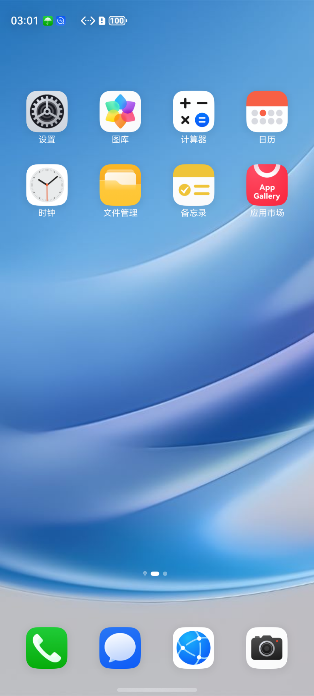

# P60P Emulator Research

在 Linux aarch64 官方华为模拟器中研究、适配并运行手机 HarmonyOS 真机 system 镜像的开源笔记与辅助工具。

**本仓库不分发华为真机 ROM、模拟器镜像、SDK、Emulator、HAP 或修改后的华为二进制。**使用者需要自行合法准备这些文件。二进制补丁以版本、偏移、原字节和目标字节的形式发布，并带严格校验。



## 当前状态

已在实际工作区验证：

- 手机 system 与模拟器内核、vendor/sys_prod 组合启动；
- host 与 guest 桌面显示一致，OpenGL ES 由 host 加速；
- 锁屏、解锁、滑动、设置 APP、桌面图标和电源键可用；
- 全局 SELinux 为 `Enforcing`，HDC shell 为 root；
- 分辨率设为 1220×2700、444 dpi；
- launcher 空布局可在启动时自动修复，非空布局不会被覆盖。

尚未解决：华为账号/应用市场登录所需的 OUCS 匿名设备证明与 TSMS 凭证，依赖 TEE 的服务、部分 root CLI、真机专用外设。详见[已知问题](docs/known-issues.md)。

> 历史工作目录称为 `p60p_rom`，但实际包标识为 `ALN-AL00`，系统属性显示 Mate 60 Pro；当前屏幕参数则按 P60 Pro 设置。项目名称保留历史称呼，不把三者混称为同一硬件。

## 环境

- Linux aarch64，KVM 可用，带 X11 图形会话；
- 华为 DevEco Studio/SDK 中的 Emulator 和 HDC；当前二进制补丁对应 Emulator 26.0.0.402；
- 自行准备的手机 ROM 与官方模拟器镜像；
- Python 3、e2fsprogs（`debugfs`）、`erofs-utils`；
- 可选：`aarch64-linux-musl-gcc`，用于编译触控工具；Pillow，用于 X11 截图工具。

仅测试过上述环境。macOS 命令和路径不能直接照搬到本仓库的 Linux aarch64 补丁。

## 快速开始

镜像准备不是已经验证的一键流程。先按[镜像准备](docs/image-preparation.md)和[补丁清单](patches/README.md)，在自己的工作区生成适配后的 imageRoot。

然后：

```sh
cp config.example.sh config.sh
$EDITOR config.sh

# 检查配置并前台启动；也可放入自己的长期后台任务
scripts/run_emulator.sh

# 另一个终端：HDC、boot、SELinux 和 launcher 检查
scripts/smoke_check.sh

# 截图保存到 work/screenshots/
scripts/capture_screenshot.sh
```

长期运行时建议使用终端多路复用器或 `setsid`/`nohup`，不要给 Emulator 外层命令设置几分钟的自动 kill 时限。

`config.sh` 至少配置：

```sh
P60P_SDK_ROOT=/path/to/sdk
P60P_IMAGE_ROOT=/path/to/image_root
P60P_INSTANCE_PATH=/path/to/deployed
P60P_INSTANCE_NAME=HarmonyOS_P60P
P60P_HDC_PORT=5555
P60P_DISPLAY=:0
P60P_XAUTHORITY=/path/to/xauthority-if-needed
```

所有仓库生成物默认进入 `work/`，不会写系统 `/tmp`。`config.sh` 已被忽略，不应提交个人路径。

## 文档导航

- [架构与最终方案](docs/architecture.md)
- [镜像解包、修改与实例组装](docs/image-preparation.md)
- [显示、GPU 与 boot-complete](docs/display-and-gpu.md)
- [SELinux 与 root](docs/selinux-and-root.md)
- [桌面布局自动修复](docs/launcher.md)
- [触控、截图与日常操作](docs/operations.md)
- [华为账号、设备证明与 TEE](docs/account-and-tee.md)
- [已知问题](docs/known-issues.md)
- [故障排查](docs/troubleshooting.md)
- [Emulator 二进制补丁经验](docs/patching-experience.md)
- [补丁与版本](patches/README.md)
- [历史调研笔记](docs/research-notes/README.md)

历史笔记按时间保留，包含已被后续实验推翻的结论。复现以顶层最终文档为准，不要把历史命令直接拼接执行。

## 安全与许可

本项目用于系统兼容性和安全研究。root、关闭指定签名校验以及放宽部分 SELinux 域会降低安全性，不应处理生产数据或不受信应用。项目不伪造华为设备证明，也不提供绕过服务器账号风控的方法。

原创脚本、源码和文档采用 MIT 许可；第三方组件与商标边界见 [NOTICE.md](NOTICE.md)。
